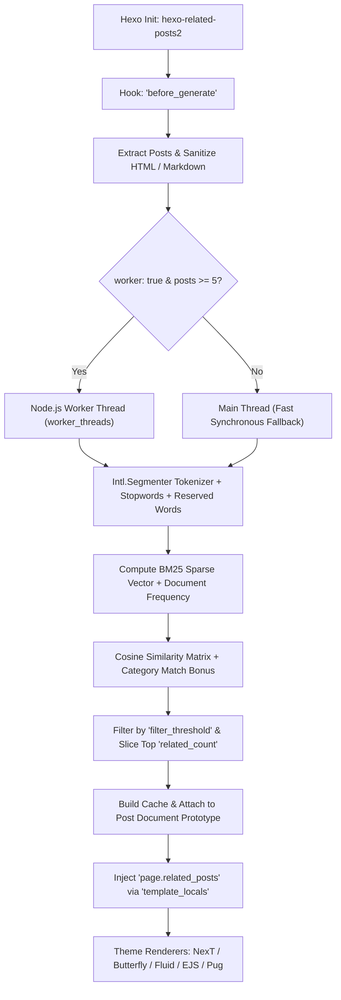

<div align="center">

# ⚡ hexo-related-posts2

**Blazing fast, zero-dependency related posts recommendation plugin for Hexo 7 & 8.**  
Powered by native **BM25 sparse vector cosine similarity** and **Node.js Worker Threads**.

[](https://www.npmjs.com/package/hexo-related-posts2)
[](https://nodejs.org/)
[](https://hexo.io/)
[](https://www.npmjs.com/package/hexo-related-posts2)
[](LICENSE)
[](tests)

[English](./README.md) • [简体中文](./README.zh-CN.md)

</div>

---

## 🌟 Highlights

- 🚀 **Blazing Fast BM25**: Employs the industry-standard Robertson-Spärck Jones BM25 algorithm combined with sparse vector cosine similarity — substantially more accurate and faster than naive TF-IDF.
- 🧵 **Multi-Threaded Concurrency**: Offloads the $O(N^2)$ pairwise similarity calculation matrix to Node.js `worker_threads`, keeping Hexo's main build pipeline completely smooth and unblocked.
- 📦 **Zero Runtime Dependencies**: Powered entirely by native Node.js built-ins (`Intl.Segmenter`, `worker_threads`). No native C++ compilation, no 100MB+ dictionary downloads, no install friction.
- 🌐 **First-Class CJK & Multilingual NLP**: Built on V8's native `Intl.Segmenter` for seamless word segmentation across Chinese, English, Japanese, French, and mixed multilingual texts.
- 🛡️ **Preserved Words Protection**: Preserves technical keywords and compound terms (e.g., `ASP.NET`, `C++`, `Vue.js`, `Node.js`) without accidental word splitting.
- 🔄 **100% Drop-in Compatibility**: Fully compatible with legacy `hexo-related-posts` configurations and mainstream Hexo themes (NexT, Butterfly, Fluid, Stellar, etc.).
- 🧪 **Spec-Driven Quality (SDD)**: Built following Specification-Driven Development, with full integration tests verified across both **Hexo 7.3+** and **Hexo 8.x**.

---

## 📊 Comparison with Legacy Plugin

| Feature | Legacy `hexo-related-posts` | `hexo-related-posts2` |
|:---|:---:|:---:|
| **Core Algorithm** | Basic TF-IDF | **Modern BM25 + Cosine Similarity** |
| **Execution Model** | Single-threaded synchronous blocking | **Multi-threaded Worker Threads** |
| **Chinese (CJK) Support** | Poor (Requires heavy 3rd-party stemmers) | **Native (`Intl.Segmenter` built into V8)** |
| **Runtime Dependencies** | Heavy (`natural` ~100MB+ on disk) | **Zero (0 KB runtime dependencies)** |
| **Reserved Words** | Regex replacement | **Exact Boundary Token Preservation** |
| **Hexo 7 & 8 Support** | Untested on modern versions | **Fully tested & certified for Hexo 7 & 8** |
| **TypeScript Definitions** | No types | **Full TypeScript types exported** |

---

## 🏗️ Architecture



---

## 📦 Installation

Install into your Hexo blog root:

```bash
# Using npm
npm install hexo-related-posts2 --save-dev

# Using pnpm
pnpm add -D hexo-related-posts2

# Using yarn
yarn add -D hexo-related-posts2
```

> [!TIP]
> Hexo will automatically recognize and load any plugin matching the `hexo-*` naming convention. No manual plugin registration in `_config.yml` is required!

---

## ⚙️ Configuration

Add the `related_posts` section to your blog's root `_config.yml`:

```yaml
related_posts:
  enable: true                 # Enable / disable the plugin
  enable_env_name: prod        # Optional: run only when --prod or HEXO_ENV=prod
  filter_threshold: 0.2        # Minimum similarity score (0.0 ~ 1.0)
  related_count: 5             # Maximum number of related posts to return
  weight:
    title: 5                   # Weight for post title
    description: 2             # Weight for post description
    keywords: 3                # Weight for post keywords
    tags: 5                    # Weight for post tags
    categories: 0.2            # Bonus weight for matching categories
    text: 1                    # Weight for main content text
  reserved:                    # Terms protected from word splitting
    - ASP.NET
    - C++
    - Vue.js
    - Node.js
    - .NET
  locale: zh-CN                # Language locale for Intl.Segmenter
  worker: true                 # Enable multi-threaded calculation
```

### Options Reference

| Key | Type | Default | Description |
|:---|:---:|:---:|:---|
| `enable` | `boolean` | `true` | Toggle plugin execution (`enabled` is also supported as an alias). |
| `enable_env_name` | `string` | `undefined` | Only run in specific environments (e.g. `prod` runs when using `hexo generate --prod` or `HEXO_ENV=prod`). |
| `filter_threshold` | `number` | `0.2` | Minimum similarity score required for recommendation. Increase to show only highly relevant posts; decrease to be more lenient. |
| `related_count` | `number` | `5` | Maximum number of recommended posts returned per page. |
| `weight.title` | `number` | `5` | Relative token weight for titles. |
| `weight.description` | `number` | `2` | Relative token weight for post descriptions/excerpts. |
| `weight.keywords` | `number` | `3` | Relative token weight for keywords. |
| `weight.tags` | `number` | `5` | Relative token weight for post tags (`tag:<name>`). |
| `weight.categories` | `number` | `0.2` | Boost score applied when two posts share categories. |
| `weight.text` | `number` | `1` | Relative token weight for post body content. |
| `reserved` | `string[]` | `[]` | Exact technical terms or compound words that should remain intact without token splitting. |
| `locale` | `string` | `'zh-CN'` | BCP 47 locale tag passed to `Intl.Segmenter` (e.g., `'zh-CN'`, `'en-US'`, `'ja-JP'`). |
| `worker` | `boolean` | `true` | Execute similarity matrix calculation in background `worker_threads`. |
| `min_docs_for_worker`| `number` | `5` | Runs synchronously on the main thread if post count is below this number. |
| `stop_words` | `string[]` | `[]` | Additional custom stop words to ignore during tokenization. |

> [!NOTE]
> **Backward Compatibility**: If you migrate from legacy `hexo-related-posts` with fractional weights (e.g. `weight.title: 0.05, weight.text: 1`), `hexo-related-posts2` automatically detects and translates them into appropriate BM25 multipliers.

---

## 🎨 Theme Integration

`hexo-related-posts2` automatically injects `page.related_posts` (array of post paths, e.g. `['2023/10/first-post/', ...]`) and defines `post.related_posts` on all Post model instances.

### 1. Hexo NexT Theme

In your NexT theme configuration `_config.next.yml`:

```yaml
# Related popular posts
# Dependencies: hexo-related-posts2
related_posts:
  enable: true
  title: Related Posts
  display_in_home: false
```

### 2. Hexo Butterfly Theme

In your `_config.butterfly.yml`:

```yaml
related_post:
  enable: true
  limit: 5
  date_type: created
```

### 3. Custom EJS Template

```ejs
<% if (page.related_posts && page.related_posts.length > 0) { %>
  <section class="related-posts">
    <h3>Related Articles</h3>
    <ul class="related-posts-list">
      <% page.related_posts.forEach(function(postPath) { %>
        <% var targetPost = site.posts.findOne({ path: postPath }); %>
        <% if (targetPost) { %>
          <li>
            <a href="<%- url_for(targetPost.path) %>">
              <%= targetPost.title || 'Untitled' %>
            </a>
            <span class="date"><%= date(targetPost.date, 'YYYY-MM-DD') %></span>
          </li>
        <% } %>
      <% }); %>
    </ul>
  </section>
<% } %>
```

### 4. Custom Nunjucks Template

```njk

  <div class="related-posts-box">
    <h4>Related Posts</h4>
    <ul>
      
        
        
          <li><a href="{{ url_for(postItem.path) }}">{{ postItem.title }}</a></li>
        
      
    </ul>
  </div>

```

---

## 🔬 Mathematical Model

The plugin applies the standard **Robertson-Spärck Jones BM25** formulation:

### 1. IDF (Inverse Document Frequency)
$$\text{IDF}(w) = \ln\left(1 + \frac{N - DF(w) + 0.5}{DF(w) + 0.5}\right)$$

### 2. Term Saturation & Length Normalization
$$\text{TF}_{\text{BM25}}(w, D) = \frac{\text{freq}(w, D) \cdot (k_1 + 1)}{\text{freq}(w, D) + k_1 \cdot \left(1 - b + b \cdot \frac{|D|}{\text{avgdl}}\right)}$$
*Standard constants: $k_1 = 1.5$, $b = 0.75$.*

### 3. Sparse Vector Cosine Similarity
$$\text{sim}_{\text{BM25}}(A, B) = \frac{\sum_{w \in A \cap B} \mathbf{v}_A(w) \cdot \mathbf{v}_B(w)}{\|\mathbf{v}_A\| \cdot \|\mathbf{v}_B\|}$$

---

## 🛠️ Programmatic API

You can also use the core calculation utilities directly in your own scripts or automated pipelines:

```typescript
import { calculateBM25, tokenize, resolveConfig } from 'hexo-related-posts2';

const docs = [
  {
    id: 'post-1',
    path: 'posts/docker/',
    title: 'Docker & Kubernetes Handbook',
    content: 'Container orchestration with Kubernetes and Docker.',
    tags: ['Docker', 'DevOps'],
    categories: ['Cloud'],
  },
  {
    id: 'post-2',
    path: 'posts/k8s/',
    title: 'Istio Service Mesh in Kubernetes',
    content: 'Traffic routing and resilience in Kubernetes.',
    tags: ['Kubernetes', 'DevOps'],
    categories: ['Cloud'],
  },
];

const config = resolveConfig({ filter_threshold: 0.1 });
const relations = calculateBM25(docs, config);
// relations: { 'post-1': ['post-2'], 'post-2': ['post-1'] }
```

---

## 🧪 Testing

The test suite runs with [Vitest](https://vitest.dev/) and covers:
- Tokenizer sanitization & `Intl.Segmenter` Chinese/English token generation
- Reserved words protection without word splitting
- BM25 sparse vector calculation & threshold filtering
- Background `worker_threads` vs synchronous execution consistency
- Real **Hexo 7.3.0** integration lifecycle
- Real **Hexo 8.1.2** integration lifecycle

```bash
# Run tests
pnpm test

# Run type check
pnpm typecheck

# Build bundle
pnpm build
```

---

## 📄 License

[MIT](./LICENSE) © [Wyatex](https://github.com/wyatex)
