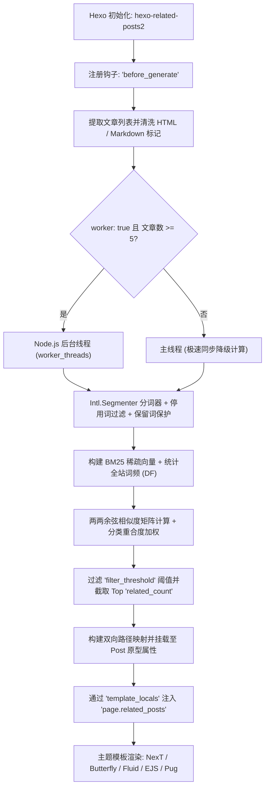

<div align="center">

# ⚡ hexo-related-posts2

**极速、零外部运行时依赖的 Hexo 7 与 Hexo 8 相关文章推荐插件。**  
基于现代 **BM25 稀疏向量余弦相似度模型** 与 **Node.js 多线程 Worker Threads** 驱动。

[](https://www.npmjs.com/package/hexo-related-posts2)
[](https://nodejs.org/)
[](https://hexo.io/)
[](https://www.npmjs.com/package/hexo-related-posts2)
[](LICENSE)
[](tests)

[English](./README.md) • [简体中文](./README.zh-CN.md)

</div>

---

## 🌟 核心亮点

- 🚀 **现代高精度 BM25 算法**：采用工业级 Robertson-Spärck Jones BM25 算法结合稀疏向量余弦相似度，相似度相关性与排序质量远超传统朴素 TF-IDF。
- 🧵 **多线程并发计算**：将复杂度为 $O(N^2)$ 的两两文档相似度矩阵运算完全卸载至 Node.js `worker_threads` 后台线程池，保障 Hexo 静态页面渲染主进程毫不卡顿。
- 📦 **零运行时外部依赖（Zero Dependencies）**：全面采用 Node.js 原生底层能力（`Intl.Segmenter`、`worker_threads`），无需安装臃肿的第三方分词库或编译 C++ 插件，装包体积小、安装秒级完成。
- 🌐 **原生级中文（CJK）与多语言支持**：借助 V8 引擎原生的 `Intl.Segmenter` 分词器，无需百兆词典即可天然精准切分中文、英文、日文以及中英混合技术文档。
- 🛡️ **专有名词与保留词保护**：支持配置保留词（如 `ASP.NET`、`C++`、`Vue.js`、`Node.js`），在分词阶段完整保留专有名词，杜绝符号丢失或拆碎词义。
- 🔄 **无缝平替与生态兼容**：100% 兼容经典 `hexo-related-posts` 的配置语法，并无缝适配主流 Hexo 主题（NexT、Butterfly、Fluid、Stellar 等）。
- 🧪 **规范驱动开发（SDD）**：严格按照规范驱动开发制定模型标准，并通过 **Hexo 7.3+** 与 **Hexo 8.x** 双版本的全套真实生命周期自动化测试。

---

## 📊 与传统插件对比

| 特性 | 传统 `hexo-related-posts` | `hexo-related-posts2` |
|:---|:---:|:---:|
| **核心算法** | 基础 TF-IDF 算法 | **现代 BM25 稀疏向量余弦模型** |
| **执行机制** | 单线程同步阻塞构建 | **多线程 Worker Threads 并发运算** |
| **中文与 CJK 支持** | 差（需依赖笨重的三方 stemmer） | **原生卓越（Node 原生 `Intl.Segmenter`）** |
| **运行时依赖** | 庞大（依赖 `natural`，磁盘占用 > 100MB） | **零依赖（0 KB 外部运行时依赖）** |
| **保留词机制** | 简易正则替换 | **精准词界匹配与保留** |
| **Hexo 7 & 8 兼容** | 现代高版本未验证 | **深度适配并通过 Hexo 7 与 Hexo 8 测试** |
| **TypeScript 支持** | 无类型定义 | **100% TypeScript 导出完整类型** |

---

## 🏗️ 架构流程



---

## 📦 安装指南

在您的 Hexo 博客项目根目录下运行：

```bash
# 使用 npm
npm install hexo-related-posts2 --save-dev

# 使用 pnpm
pnpm add -D hexo-related-posts2

# 使用 yarn
yarn add -D hexo-related-posts2
```

> [!TIP]
> Hexo 会自动扫描以 `hexo-*` 开头的插件依赖并加载，无需在 `_config.yml` 的 `plugins` 中手动声明！

---

## ⚙️ 参数配置

在博客根目录的 `_config.yml` 中添加 `related_posts` 配置块：

```yaml
related_posts:
  enable: true                 # 是否启用相关文章插件
  enable_env_name: prod        # 可选：仅在指定环境（如 --prod 或 HEXO_ENV=prod）下计算
  filter_threshold: 0.2        # 相似度最低分数阈值（0.0 ~ 1.0）
  related_count: 5             # 推荐文章的最大展示数量
  weight:
    title: 5                   # 标题分词权重倍数
    description: 2             # 描述/摘要分词权重倍数
    keywords: 3                # 关键词权重倍数
    tags: 5                    # 标签权重倍数
    categories: 0.2            # 分类相同时的加成权重
    text: 1                    # 正文分词权重
  reserved:                    # 保护不被切开的专有名词
    - ASP.NET
    - C++
    - Vue.js
    - Node.js
    - .NET
  locale: zh-CN                # Intl.Segmenter 语言环境
  worker: true                 # 是否启用多线程 Worker 计算
```

### 完整配置项详解

| 参数键名 | 类型 | 默认值 | 说明 |
|:---|:---:|:---:|:---|
| `enable` | `boolean` | `true` | 插件总开关（亦支持别名 `enabled`）。 |
| `enable_env_name` | `string` | `undefined` | 条件构建环境标识。若配置为 `prod`，则仅在 `hexo g --prod` 或环境变量 `HEXO_ENV=prod` 时执行计算。 |
| `filter_threshold` | `number` | `0.2` | 最低相似度阈值。调大该数值可过滤掉关联较弱的文章，调小则更宽容。 |
| `related_count` | `number` | `5` | 最终注入到单篇文章中的最大相关文章条数。 |
| `weight.title` | `number` | `5` | 文章标题特征词权重。 |
| `weight.description` | `number` | `2` | 文章描述与摘要特征词权重。 |
| `weight.keywords` | `number` | `3` | 文章关键词特征词权重。 |
| `weight.tags` | `number` | `5` | 文章标签特征权重（以 `tag:<name>` 融入）。 |
| `weight.categories` | `number` | `0.2` | 分类重合度加成比例。两篇处于同一分类的文章将获得适当加权。 |
| `weight.text` | `number` | `1` | 文章主体正文特征词的基础权重。 |
| `reserved` | `string[]` | `[]` | 专有名词保留清单。防止如 `ASP.NET`、`C++` 等词汇被拆分为单个字母。 |
| `locale` | `string` | `'zh-CN'` | BCP 47 语言标识，用于 `Intl.Segmenter` 分词（如 `'zh-CN'`, `'en-US'`, `'ja-JP'`）。 |
| `worker` | `boolean` | `true` | 是否启动 Node.js `worker_threads` 后台多线程并行计算相似度。 |
| `min_docs_for_worker`| `number` | `5` | 当文章总数小于该阈值时自动在主线程同步计算，避免线程调度开销。 |
| `stop_words` | `string[]` | `[]` | 用户自定义停用词列表，用于追加过滤掉无实际语义的高频字词。 |

> [!NOTE]
> **向后平滑兼容**：如果您此前在 `hexo-related-posts` 中使用了小数级权重（如 `weight.title: 0.05, weight.text: 1`），插件会自动识别并等比放大至 BM25 推荐算法的最佳区间。

---

## 🎨 主题集成指南

插件会在静态生成前自动建立全站文章关联索引，并在模板上下文中注入 `page.related_posts`（文章路径数组，例如 `['2023/10/first-post/', ...]`)，同时在所有 Post 数据模型上提供 `post.related_posts` 属性。

### 1. Hexo NexT 主题

在您的 NexT 主题配置文件 `_config.next.yml` 中开启：

```yaml
# 相关文章推荐
# 依赖插件: hexo-related-posts2
related_posts:
  enable: true
  title: 相关文章推荐
  display_in_home: false
```

### 2. Hexo Butterfly 主题

在您的 `_config.butterfly.yml` 中配置：

```yaml
related_post:
  enable: true
  limit: 5
  date_type: created
```

### 3. 自定义 EJS 模板

```ejs
<% if (page.related_posts && page.related_posts.length > 0) { %>
  <section class="related-posts">
    <h3>相关阅读推荐</h3>
    <ul class="related-posts-list">
      <% page.related_posts.forEach(function(postPath) { %>
        <% var targetPost = site.posts.findOne({ path: postPath }); %>
        <% if (targetPost) { %>
          <li>
            <a href="<%- url_for(targetPost.path) %>">
              <%= targetPost.title || '无标题' %>
            </a>
            <span class="date"><%= date(targetPost.date, 'YYYY-MM-DD') %></span>
          </li>
        <% } %>
      <% }); %>
    </ul>
  </section>
<% } %>
```

### 4. 自定义 Nunjucks 模板

```njk

  <div class="related-posts-container">
    <h4>相关文章</h4>
    <ul>
      
        
        
          <li><a href="{{ url_for(postItem.path) }}">{{ postItem.title }}</a></li>
        
      
    </ul>
  </div>

```

---

## 🔬 数学模型与算法原理

本插件基于经典的 **Robertson-Spärck Jones BM25** 检索加权体系构建：

### 1. 逆文档频率 (IDF)
$$\text{IDF}(w) = \ln\left(1 + \frac{N - DF(w) + 0.5}{DF(w) + 0.5}\right)$$

### 2. 词频饱和度与篇幅归一化 (TF Saturation)
$$\text{TF}_{\text{BM25}}(w, D) = \frac{\text{freq}(w, D) \cdot (k_1 + 1)}{\text{freq}(w, D) + k_1 \cdot \left(1 - b + b \cdot \frac{|D|}{\text{avgdl}}\right)}$$
*标准参数取值：$k_1 = 1.5$，$b = 0.75$。*

### 3. 稀疏向量两两余弦相似度 (Cosine Similarity)
$$\text{sim}_{\text{BM25}}(A, B) = \frac{\sum_{w \in A \cap B} \mathbf{v}_A(w) \cdot \mathbf{v}_B(w)}{\|\mathbf{v}_A\| \cdot \|\mathbf{v}_B\|}$$

---

## 🛠️ 编程式 API

您还可以直接引入核心模块，用于您自己的自动化脚本、数据分析或测试管线：

```typescript
import { calculateBM25, tokenize, resolveConfig } from 'hexo-related-posts2';

const docs = [
  {
    id: 'p-1',
    path: 'posts/docker-k8s/',
    title: 'Docker 与 Kubernetes 进阶实战',
    content: '容器化编排与微服务网络治理深入剖析。',
    tags: ['Docker', 'DevOps'],
    categories: ['云原生'],
  },
  {
    id: 'p-2',
    path: 'posts/istio-mesh/',
    title: 'Istio 服务网格架构指南',
    content: '在 Kubernetes 集群中实现微服务流量调度与灰度发布。',
    tags: ['Kubernetes', 'DevOps'],
    categories: ['云原生'],
  },
];

const config = resolveConfig({ filter_threshold: 0.1 });
const relations = calculateBM25(docs, config);
// relations: { 'p-1': ['p-2'], 'p-2': ['p-1'] }
```

---

## 🧪 自动化测试

项目基于 [Vitest](https://vitest.dev/) 构建了完善的测试用例体系，覆盖以下维度：
- 文本清洗与 V8 原生 `Intl.Segmenter` 中英文分词
- 专有名词保留（Reserved Words）避免拆词
- BM25 稀疏向量计算、分类加成及阈值过滤
- 后台多线程 Worker 并发与同步降级的一致性校验
- **Hexo 7.3.0** 真实生命周期与模板注入集成测试
- **Hexo 8.1.2** 真实生命周期与模板注入集成测试

```bash
# 执行全部单元与集成测试
pnpm test

# 执行 TypeScript 类型检查
pnpm typecheck

# 编译打包 CJS 与 ESM 产物
pnpm build
```

---

## 📄 开源许可证

本项目遵循 [MIT](./LICENSE) 许可证发布。版权所有 © [Wyatex](https://github.com/wyatex)。
